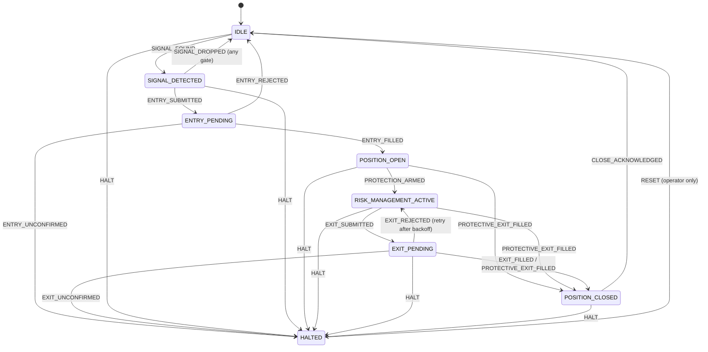

# Architecture

This document records the trade lifecycle, the invariants the code enforces, and the failure
modes the design is built around. The README covers operation and configuration.

## 1. Components

| Layer | Module | Responsibility |
| --- | --- | --- |
| Config | `src/config.ts` | Validated env. Live needs an explicit acknowledgement. Cross-field rules (session order, risk ≤ daily loss). |
| Auth | `src/dhan/auth.ts`, `src/dhan/client.ts` | OTP login (PIN + TOTP) or a static token, never both. One token manager serves REST and both WebSocket feeds. Renewal is single-flight. |
| Time | `src/time/ist.ts`, `calendar.ts` | All session logic on IST minutes. Epoch conversion is explicit (`DHAN_EPOCH_IST_SHIFTED`). |
| Market data | `src/dhan/marketData.ts`, `instrumentMaster.ts`, `feed.ts` | Charts, expiries, option chain (account-wide 3 s throttle), scrip master (exact symbol lookup, fail-closed), WS feed with receipt-time freshness. |
| Signal | `src/market/*`, `src/strategy/orbSupertrend.ts` | Bar aggregation from ticks; closed-bar indicators; ORB + SuperTrend signal. |
| Contract | `src/options/*` | Expiry, strike and quote selection; bracket geometry; whole-lot sizing. |
| Gate | `src/risk/*` | Pure pre-trade gate returning all violations; day book with kill switch and cooldown. |
| Advice | `src/llm/advisor.ts` | Ollama structured output, veto only, fail-closed. |
| Venue | `src/execution/paper.ts`, `src/dhan/liveExecution.ts` | Same `ExecutionPort` contract. Paper simulates; live places super orders. |
| Orchestration | `src/runtime/*` | Serial per-underlying agent; orchestrator with routing, clock, breach handling, shutdown. |
| Audit | `src/ops/*` | JSONL journal, one file per IST day (serialised writes), IST console logger, bounded in-memory log for the cockpit, journal summary. |
| Cockpit | `src/ui/*`, `src/runtime/views.ts` | Read-only snapshot (`Orchestrator.snapshot`) rendered by a pure renderer and an Ink app. Three operator actions (close, entry block, stop), each behind a second press. |

## 2. Trade lifecycle (per underlying)

The table in `src/domain/fsm.ts` is the source of truth. Any (state, event) pair not in it throws
`IllegalTransitionError`, and the state is left unchanged. `fsm.test.ts` checks that every row
targets a declared state and that HALT is never legal in HALTED.

Two states the diagram does not show are legal and matter in operation:

- **Late fills while HALTED.** An entry that was unconfirmed and then fills at the broker is
  recorded as a late fill for risk accounting. The FSM stays HALTED, so the operator sees it.
  A halt stops entries, not protection: the position still gets its time stop, daily-loss,
  end-of-day, manual and shutdown exits, unless an exit was already sent for it and its
  outcome is unknown (a second SELL could leave the account net short).
- **Protective closes while HALTED.** A bracket leg that closes the position still updates day P&L
  and clears the position record. The state stays HALTED.

## 3. Invariants

1. **Buy-to-open only.** `EntryOrder.side` is the literal `'BUY'`. The risk gate also rejects any
   non-BUY entry, so the rule holds at both the type and the runtime level.
2. **Stop and target are mandatory.** `bracketLevels` returns undefined rather than a bracket
   without a stop. The SDK super-order schema independently requires both fields.
3. **Risk fits the budget.** `lots = floor(budget / (lotSize × (entry − stop)))`. The gate recomputes
   risk from the order's own numbers.
4. **Exit quantity ≤ broker net long.** Live `submitExit` reads `positions.list`, sends
   `min(requested, netQty)`, and sends nothing when `netQty ≤ 0`. Net short halts.
5. **One terminal outcome per order.** Terminal events are keyed (`entry:`, `exit:`, `protective:`,
   `late-fill:`). A reconciliation fill and a waiter fill for the same order cannot both reach the FSM.
6. **No replay of trading writes.** The SDK sends each trading write at most once. The adapter maps
   only definitive 4xx responses (not 401, 408, 429) to REJECTED. Everything else is UNCONFIRMED.
7. **Ordering on breach.** Daily loss blocks entries first, then flattens through normal exits. The
   broker kill switch engages only once no position is open, because Dhan refuses to activate it
   while a position or order is open. Halts follow the same rule, and a halted agent's unresolved
   entry does not hold it back. It is tried again each time the book goes from holding a position
   to holding none, so a late fill that is later closed still ends with the switch engaged.
8. **Clock sanity before trading.** `assertWarmupClock` refuses to start when bar timestamps are
   ahead of the wall clock, or a same-day series is far behind it during a session.
9. **Stale means no entry.** Spot freshness is measured on local receipt time. Option quote freshness is the age of the chain snapshot used for selection, measured when the risk gate runs, after the REST calls. Missing data counts as stale. After the advisor, the entry window and spot freshness are checked again (`STALE_AT_SUBMIT`). The quote is not re-read: the entry is a LIMIT at the gated price, so a moved market can leave it unfilled but cannot fill it above the sized risk.
10. **Advisor is a veto.** Its output is one of two values, and its failures are SKIP.

## 4. Failure-mode matrix

| Failure | Detection | Response |
| --- | --- | --- |
| Feed disconnect | `ageMs` grows past `FEED_STALE_MS` | No new entries. Live positions keep their broker brackets. Paper SL and target cannot fire until ticks resume. |
| Chart or chain request fails | exception in `prepareEntry` | Signal dropped with `DATA_UNAVAILABLE`. No position change. |
| Entry HTTP timeout or 5xx | `classifyPlacementError` → UNCONFIRMED | Underlying HALTED. Broker kill switch once no position is open. Reconciliation watches for a late fill, which is then exited like any position. |
| Entry never reaches a terminal status | `ORDER_TIMEOUT_MS` | ENTRY_UNCONFIRMED, as above. |
| Exit leg cancel fails, position still long | `brokerPosition` after cancels | EXIT_UNCONFIRMED, no SELL sent. HALTED. |
| Exit placement rejected (4xx) | `classifyPlacementError` → REJECTED | EXIT_REJECTED. Position stays open. Retry after 10 s. |
| Broker shows position that was closed by bracket | reconciliation (`netQty = 0`) | PROTECTIVE_EXIT_FILLED with reason EXTERNAL. P&L recorded. |
| Broker shows net short | reconciliation or exit guard | BROKER_MISMATCH → HALTED → broker kill switch. |
| Gap through the stop (paper) | `onOptionTick` with `ltp ≤ stop` | Fill at the LTP, not at the stop. Daily-loss check may trip. |
| Daily loss breached | `enforceDailyLoss` on the clock | Book kill switch. Agents flatten with DAILY_LOSS. Broker kill switch once flat. The breach is latched separately, so it is still recorded and armed when an operator block already holds the switch. |
| Operator block, halt, breach or stop during market data or advisor review | `entryBlockReason` before `ENTRY_SUBMITTED` | Signal dropped with `ENTRY_BLOCKED`. Nothing is submitted. |
| Stop while a signal is being prepared | `isFlat()` is false in `SIGNAL_DETECTED` | Stop waits for the signal to settle. It is then dropped, so no entry can fill after the stop reports flat. |
| Shutdown exit rejected by the venue | `onExitRejected` during shutdown | Retried on option ticks and on each shutdown poll, within the 10 s backoff, until flat or the shutdown timeout. |
| Stop during start | `stopRequested` checkpoints in `startInternal` | The start arms no feed, subscription or clock. Stop waits for an in-flight start, bounded by the shutdown timeout. |
| Operator entry block or clear | `operator_entry_block` / `operator_entry_clear` journal events | Replayed in order on restart, so a block survives a restart and a clear is not undone by replay. |
| Process restart with open broker position | `brokerOpenOptionCount` at start | Refuses to start. Operator reconciles. |
| Dhan login rejected (wrong PIN, wrong or stale TOTP) | `AuthenticationError` from `createDhanClient` | Startup stops and prints the broker reason. Nothing is traded. |
| Login returns no usable expiry, or an already-expired token | `assertUsableToken` at startup | Startup refused. Without an expiry the SDK would log in again on every request. |
| Access token rejected mid-session (401) | HTTP 401 → `onTokenExpired` | One renewal shared by all in-flight calls: renew while valid, otherwise PIN + TOTP. Trading writes that got a 401 are not resent. The next call uses the renewed token. |
| Process restart with day state | `restoreDayBook` from today's journal file | P&L, trade count, cooldown, and today's breach are restored. Only the current IST day's file is read. A malformed line in it refuses startup. |
| Event log write fails | `EventLog` error callback | Logged to console. Trading is not blocked. |
| Advisor down or slow | timeout / exception in `review` | SKIP (fail-closed). |
| Wrong epoch convention | `assertWarmupClock` at start | Refuses to start. |
| Shutdown with open position | `Orchestrator.stop` | SHUTDOWN exit. Bounded wait. Warns if still open. |

## 5. Threading model

Node is single-threaded. Concurrency comes from async I/O, so the serial queue is what makes
transitions deterministic. Each `UnderlyingAgent` has one `SerialQueue`. Spot ticks, option
ticks, the clock, and execution events are enqueued, and each task runs to completion before the
next. Two concurrent sources are safe:

- **Bars** are upserted synchronously on tick. Only the signal evaluation is queued.
- **Paper fills** are emitted from a microtask, so the agent never re-enters its own transition.
- **Entry preparation** (expiry, chain and funds calls, then the advisor) runs off the queue, so
  it never holds up the other side's exits. The slot stays `SIGNAL_DETECTED` until a queued step
  re-checks every block and submits or drops the entry.

The shared `DayBook` is mutated only from agent tasks and the orchestrator clock. Both run on
the same event loop and do not interleave within a synchronous block.
