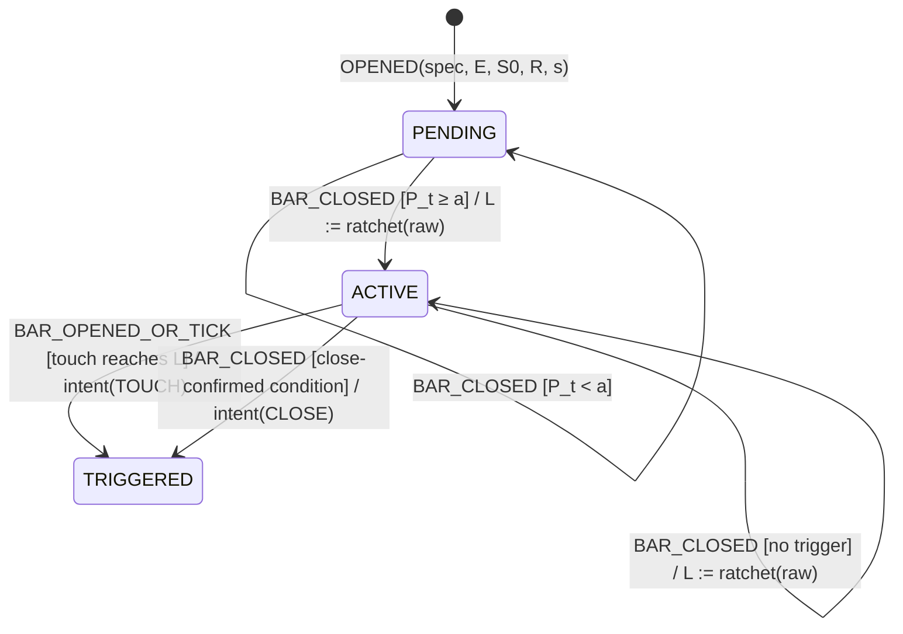

# Trailing stops: research and implementation specification

Status: Phases 1–4 implemented on branch `feat/trailing-stop-research` (2026-11-03): indicators, trail engine, fixed-entry
study, statistics and CLI (`npm run trail-study`). Live wiring (Phase 6) is not started. Results: §12. Written against
`main` at `32874ca`.

This spec covers 18 trailing-stop methods for the options-buying agent. It defines each method's formula and
state machine, how the methods are replayed and compared, the statistics a method must pass before it trades,
and how a promoted method is wired into the live agent. Scope: both underlying-price and option-premium
trails, plus hybrids. Objective: maximise profit capture (defined in §5.1).

## 0. Read this first

1. **No strategy has a net edge yet** (`ROADMAP.md`). Exit variants tried so far (stop %, R target, time stop,
   IV-crush) moved mean net R by under 0.02. A trailing stop can only redistribute the outcomes of entries that
   already exist. It cannot create an edge that the entries lack. Expect most or all methods here to fail the
   promotion gate (§7). That result is still useful: it closes the exit question and points the work back at
   entries.
2. **One trail owner per position.** Today the stop trails in two places: Dhan's super-order `trailingJump` on
   the broker side, and `calculateTrailingStop` in the agent and the paper venue. A new method replaces the
   agent-side trail. It never runs alongside `trailingJump` (§8.2).
3. **The research harness comes first, and live wiring comes last.** Only methods that pass §7 get live code.
   Methods that fail stay in `src/research/` or get deleted. Phase 6 wires at most two methods.
4. **Order-flow trailing cannot be backtested today.** Datasets carry trade prints, not quotes or depth.
   That method is data-gated (§3.17). It gets a recorder and shadow logging, not a verdict.

## 1. What exists and is reused

| Need | Existing code | Reuse |
| --- | --- | --- |
| Breakeven + fixed-jump staircase | `calculateTrailingStop` (`src/options/pricing.ts:84`) | Baseline B1, and the R-staircase method generalises it |
| Wilder ATR | `wilderAtr` (`src/market/indicators.ts:24`) | Every ATR-based method, on both spot and premium bars |
| EMA | `ema` (`indicators.ts:4`) | EMA trail |
| SuperTrend | `superTrend`, `calculateSuperTrend` (`indicators.ts:164`) | SuperTrend trail. It returns only the final-bar state, so the trail calls it once per closed bar (O(n²) per session: about 75 bars, which is acceptable for research) |
| Swing detection, MSS | `isSwingLow/High`, `marketStructure`, `structureTurnedAgainst` (`src/strategy/marketContext.ts`) | Swing, fractal and BOS/CHoCH methods. The existing `STRUCTURE_BREAK` exit is baseline B2 |
| Regime label | `marketContext().regime` (`TRENDING`/`RANGING`) | Regime-adaptive method |
| VIX terciles | `vixTerciles` (`src/research/contextCells.ts:96`) | Regime-adaptive method |
| Bar replay, bid/ask/stop fill model | `replaySession` (`src/research/replay.ts:244`) | All replay. Hook points in §4.2 |
| Charges | `roundTripChargesInr` (`pricing.ts:128`) | All net P&L |
| Day-block bootstrap, chronological split, Bonferroni cells | `bootstrapMeanR`, `resampleDays`, `chronologicalSplit` (`src/research/stats.ts`), `contextCells` | Paired tests and walk-forward (§6) |
| 1-minute NIFTY data | `data/research/NIFTY-1m-2026-*.json` | Bar-granularity sensitivity (§5.4) |

Not present, and needed: SMA, WMA, HMA, ALMA, Parabolic SAR, Donchian, fractal pivots, protected-low tracking,
a trail state machine, a fixed-entry study harness, paired bootstrap, Holm correction, and a reality-check
max-statistic test.

## 2. Notation and shared rules

| Symbol | Meaning |
| --- | --- |
| `E` | Entry fill price (premium) |
| `S0` | Initial premium stop from `bracketLevels`. Identical for every method |
| `R` | `E − S0`, premium risk per unit (> 0) |
| `q` | Quantity (lots × lot size). Identical for every method: sizing uses `S0` |
| `H_t` | Highest premium bar high since entry, through bar `t` (bid-adjusted for profit-based rules: `bid(high)`) |
| `P_t` | `(H_t − E) / R`, peak open profit in R |
| `U_t` | Underlying (spot) bar `t`: `open/high/low/close` |
| `s` | Underlying side: `+1` for a CE (bullish thesis), `−1` for a PE (bearish thesis) |
| `ATR^U_n`, `ATR^P_n` | Wilder ATR(n) on spot bars or held-strike premium bars |
| `L_t` | The method's stop level at bar `t`, in its series' units |
| `τ` | Minutes held |

### 2.1 Series and direction

- **Premium-series** levels are always long-style, because the agent only buys options. Trigger: premium
  `low_t ≤ L` (touch) or `close_t < L` (close-confirmed).
- **Underlying-series** levels use side `s`. Trigger: `s · (price − L) ≤ 0`. A CE exits when spot falls to `L`.
  A PE exits when spot rises to `L`.

### 2.2 Ratchet (applies to every method)

```
raw_t     = method formula at bar t
L_t       = L_{t-1} is undefined ? raw_t : s·max(s·L_{t-1}, s·raw_t)      // s = +1 for premium series
```

A level never moves against the position. Methods that are naturally non-monotone (EMA, ALMA, Supertrend's line
before a flip) get the ratchet anyway. The only exception is a **close-confirmed line cross** (EMA/SMA/ALMA/HMA,
CHoCH, Supertrend flip). There the exit condition is the cross itself, and no price level is ratcheted.
`L_t` is still recorded for the report.

### 2.3 Premium floor

For premium-series methods, `L_t ≥ S0` always. The trail may tighten the initial stop and never loosens it.
For underlying-series methods, `S0` stays live through the broker leg (§8.2). The underlying level is an
additional exit, never a replacement.

### 2.4 Activation

Every method has an `activationR` parameter, `a ≥ 0`. Before `P_t ≥ a`, the method is `PENDING` and only `S0`
protects the position. `a = 0` activates on the entry bar's close.

### 2.5 Timing (no lookahead)

- A level computed from bar `t` takes effect from bar `t+1`, never inside bar `t`. This is the existing replay
  rule (`replay.ts:449`) and applies to every method.
- **Touch** exits fire inside bar `t+1` when that bar's range reaches `L_t`. They fill at
  `stopFill(min(open, L))`: the stop, or the open on a gap through it.
- **Close-confirmed** exits fire at bar `t`'s close and fill at bar `t+1`'s open at `bid − stop slippage` (a market
  SELL into an adverse move). The first study run filled them at the plain bid, like `STRUCTURE_BREAK`; that handed
  close-confirmed methods a cost edge of about 0.03R over B1's stop fills and was corrected. Previously: the same as
  `STRUCTURE_BREAK` today.
- **Underlying touch** exits are detected on spot bar `t+1`. No premium print exists at the touch instant, so the
  fill is the next premium bar's open at `bid − stop slippage`. This is conservative and listed as a divergence
  in every report.
- Pivots (swing, fractal) become known only after their right-side bars close. A pivot at bar `i` with strength
  `k` is usable from bar `i + k + 1`.

## 3. Methods

Each method entry gives the formula, its family (P = premium, U = underlying), the trigger type (T = touch,
C = close-confirmed), and the parameter grid. Grids are deliberately small, because every configuration counts
against the multiple-testing budget (§6.3).

### 3.1 ATR trailing stop (U)

```
raw_t = X_t − s · k · ATR^U_n(t),   X_t = s=+1 ? highest spot high since entry : lowest spot low since entry
```
Trigger T on spot. Grid: `n = 14`, `k ∈ {2, 3}`, `a ∈ {0, 0.5}` (4 configs).

### 3.2 Chandelier Exit (U)

```
raw_t = s=+1 ? max(high_{t-m+1..t}) − k·ATR^U_n(t) : min(low_{t-m+1..t}) + k·ATR^U_n(t)
m = min(lookback, barsSinceEntry + 1)
```
The window is capped at bars since entry, so a pre-entry extreme cannot place the stop beyond the current price.
Under the ratchet, a Chandelier whose lookback is at least the bars held equals 3.1. A 60-minute hold on 5-minute
bars is 12 bars, so the lookbacks are short on purpose. Grid: `n = 14`, `lookback ∈ {6, 10}`, `k ∈ {2, 3}`
(4 configs). Trigger T.

### 3.3 Supertrend (U, P)

Reuses `superTrend(bars, period, mult)` on closed bars.
- Exit C when `trend` flips against `s` (U), or flips to `DOWN` (P).
- The line is recorded as `L_t` for reporting.

Grid: `(10, 2)`, `(10, 3)` × series {U, P} (4 configs).

### 3.4 Parabolic SAR (U, P)

As a stop only, without the reverse leg. Long form shown (P, or U with `s = +1`). The short form mirrors highs
and lows.
```
init:     SAR_0 = P ? S0 : signal-bar low;  EP_0 = entry-bar high;  AF_0 = af0
each bar: SAR_{t+1} = SAR_t + AF_t · (EP_t − SAR_t)
          SAR_{t+1} = min(SAR_{t+1}, low_t, low_{t-1})          // Wilder clamp
          if high_{t+1} > EP_t: EP = high_{t+1}; AF = min(AF + step, afMax)
raw_t = SAR_{t+1}
```
Trigger T. Grid: `(af0, step, afMax) ∈ {(0.02, 0.02, 0.2), (0.01, 0.01, 0.1)}` × {U, P} (4 configs).

### 3.5 EMA / SMA line (U, P)

```
SMA_n = mean(close_{t-n+1..t});   EMA via existing ema()
exit C:  s · (close_t − MA_t) < 0        (P: close_t < MA_t)
```
Grid: `{EMA 9, EMA 20, SMA 20}` × {U, P} (6 configs). Premium MAs need `n` premium bars. Bars from session open
are used, including pre-entry bars of the same strike. That is not lookahead, because they are already closed.

### 3.6 ALMA / HMA line (U, P)

```
WMA_n(t)  = Σ_{i=1..n} i·p_{t-n+i} / Σ i
HMA_n     = WMA_{⌊√n⌋}( 2·WMA_{⌊n/2⌋}(p) − WMA_n(p) )
ALMA:     m = offset·(n−1),  σ' = n/sigma,  w_i = exp(−(i−m)² / (2σ'²)),  i = 0..n−1 (0 = oldest)
          ALMA_t = Σ w_i · p_{t-n+1+i} / Σ w_i            defaults: offset 0.85, sigma 6
exit C as in 3.5
```
Grid: `{ALMA 9, ALMA 21, HMA 9, HMA 21}` × {U, P} (8 configs).

### 3.7 Swing low / high (U)

A structure-progressive trail: the level moves only to a **higher** confirmed swing low (CE) or a **lower**
confirmed swing high (PE).
```
on new confirmed swing low x (CE):  if x > lastAcceptedLow: lastAcceptedLow = x
raw_t = lastAcceptedLow − s · b · ATR^U_14(t)
```
Pivots use `isSwingLow/High` with strength `k`. Trigger T. Grid: `k ∈ {2, 3}`, `b ∈ {0, 0.25}` (4 configs).

### 3.8 Fractal trailing (U)

Bill Williams fractals: a low strictly below the `w` lows on each side. Unlike 3.7, it follows the latest
confirmed fractal whether or not it is higher. The ratchet still prevents loosening.
```
fractalLow at i  ⇔  low_i < low_{i-j} and low_i < low_{i+j} for j = 1..w;  usable from bar i + w + 1
raw_t = latest usable fractal low (CE) / high (PE)
```
Trigger T. Grid: `w ∈ {2, 3}` (2 configs).

### 3.9 BOS / CHoCH (U)

Tracks the **protected low**: the swing low that preceded the latest bullish break of structure. Mirrored for PE.
```
on close_t > lastSwingHigh (bullish BOS):  protected = lastSwingLow at that moment
exit C when close_t < protected (CHoCH against a CE)
```
This differs from the existing `structureTurnedAgainst`, which flips on any swing break once the trend has
changed. B2 (existing) and this method are reported side by side. Grid: strength `k ∈ {2, 3}` (2 configs).

### 3.10 Donchian channel (U, P)

```
raw_t = s=+1 (or P) ? min(low_{t-n+1..t}) : max(high_{t-n+1..t})       window capped at bars since entry
```
Trigger T. Grid: `n ∈ {3, 5, 10}` × {U, P} (6 configs). `n = 20` is dropped: at 5-minute bars it exceeds most
holds.

### 3.11 R-multiple staircase (P)

This generalises `calculateTrailingStop`.
```
if P_t ≥ a:  k = ⌊(P_t − a) / Δ⌋               // completed steps beyond activation
             raw_t = E + BE + (a − 1 + k · Δ) · R  // first lock sits 1R below the activation point
BE = 0 (gross)  or  (chargesPerUnit + halfSpread·E)  (net breakeven)
```
With `a = 1, Δ = 1`, the levels are: +1R → breakeven, +2R → +1R, +3R → +2R. With `a = 0.5`, the first lock at
+0.5R is `E − 0.5R` (halves the risk), then breakeven at +1.5R. The premium floor (§2.3) still applies. Trigger T.
Grid: `a ∈ {0.5, 1}`, `Δ = 1`, `BE ∈ {gross, net}` (4 configs). Per-unit charges come from
`roundTripChargesInr` at `(E, E)` divided by `q`.

### 3.12 Giveback trailing (P)

```
active when P_t ≥ a;   raw_t = E + (1 − g) · (bid(H_t) − E)
```
Trigger T. Grid: `a ∈ {0.5, 1}`, `g ∈ {0.3, 0.5}` (4 configs).

### 3.13 Time-decay trailing (P)

```
raw_t = H_t − k(τ) · ATR^P_14(t),   k(τ) piecewise-constant by τ bucket
```
Schedules: `A = [3.0 ≤5m, 2.5 ≤10m, 2.0 ≤15m, 1.5 after]` and `B = [2.5, 2.0, 1.5, 1.0]` at the same edges
(2 configs). Trigger T. The schedule only tightens. The ratchet stops a bucket change from loosening the level.

### 3.14 Option-premium ATR (P)

```
raw_t = H_t − k · ATR^P_n(t)
```
`ATR^P` is computed over the held strike's premium bars from session open. With fewer than `n` bars it uses
Wilder on the available bars if there are at least 3. Otherwise the method stays `PENDING`, which counts as
`fallback=insufficient_bars` in the report. Trigger T. Grid: `n = 14`, `k ∈ {1.5, 2, 3}`, `a ∈ {0, 0.5}`
(6 configs).

### 3.15 Option-premium Chandelier (P)

```
raw_t = max(high^P_{t-m+1..t}) − k · ATR^P_n(t),   m = min(lookback, barsSinceEntry + 1)
```
Grid: `n = 14`, `lookback ∈ {3, 6}`, `k ∈ {2, 3}` (4 configs). Trigger T.

### 3.16 Underlying + premium hybrid (U ∧ P)

```
exit = premiumTrailHit(P-method) OR underlyingInvalidation(U-method)
```
Pairs: `{Premium ATR k=2, Premium Chandelier lb=6 k=2} × {BOS/CHoCH k=2, Supertrend(10,3) flip}` (4 configs).
The exit reason records which leg fired. The pairs are fixed in advance rather than chosen from 3.14–3.15
results, because choosing them afterwards adds a hidden search.

### 3.17 Order-flow trailing (P, data-gated)

```
OBI_t = (Σ_{l=1..5} bidQty_l − Σ askQty_l) / (Σ bidQty_l + Σ askQty_l)     on held-strike depth snapshots
if P_t ≥ 0.5 and OBI < −θ for m consecutive snapshots:  tighten premium ATR k from k_base to k_tight
```
Defaults: `θ = 0.3`, `m = 3` (1 s snapshots), `k_base = 2`, `k_tight = 1`. It tightens and never exits directly,
because displayed depth can be withdrawn.

**Gate:** no historical depth exists. Phase 0 adds a depth recorder for the held strike and ATM±2. It records
the Dhan full packet, 5 levels, at 1 s, roughly 40 MB/day, to be estimated in Phase 0. The method is shadow-logged
in paper mode (`trail_shadow` journal events showing what it would have done). It enters a study only after
≥ 60 recorded sessions, as a separate family with its own correction. It is not part of the Phase 4 ranking.

### 3.18 Regime-adaptive (meta)

```
cell   = (marketContext.regime ∈ {TRENDING, RANGING}) × (VIX tercile ∈ {low, mid, high})   at entry
method = map[cell]      // map chosen on the training fold only
```
- Selection: in each walk-forward training fold, pick for each cell the configuration from 3.1–3.16 with the
  highest capture.
- A cell with fewer than 30 training trades uses the fold's single best configuration.
- Evaluated only on the test fold.

This counts as **one** configuration in the family, because its search is inside the training fold. It also
adds the six-cell selection risk, and that risk is visible only out of sample. A map that changes every fold is
reported as unstable, whatever its out-of-sample number.

### 3.19 Baselines

| ID | Definition |
| --- | --- |
| B0 | Bracket only: `S0`, target at `TARGET_RR`, time stop, EOD flatten. No trail |
| B1 | Current production: B0 + `calculateTrailingStop` with configured `TRAILING_JUMP_PCT` and `BREAKEVEN_AT_RR` |
| B2 | B1 + existing `STRUCTURE_BREAK` exit |

**B1 is the comparator for every test.** B0 and B2 are reported for context.

Configuration count for the primary family is **68** (`src/research/trailGrid.ts`), from 3.1–3.16. Regime-adaptive
(3.18) is scored separately inside the walk-forward, where its selection is out of sample.

## 4. Deterministic trail state machine

### 4.1 States and events



| From | Event | Guard | To | Effect |
| --- | --- | --- | --- | --- |
| — | `OPENED` | `R > 0`, spec valid | `PENDING` | state initialised, `barsHeld = 0` |
| `PENDING` | `BAR_CLOSED(series, bar)` | `P_t < a` | `PENDING` | update `H`, indicator buffers |
| `PENDING` | `BAR_CLOSED` | `P_t ≥ a` | `ACTIVE` | `L := ratchet(raw)` (§2.2), floor (§2.3) |
| `ACTIVE` | `BAR_CLOSED` | close-confirmed condition true | `TRIGGERED` | `ExitIntent{kind: CLOSE}` |
| `ACTIVE` | `BAR_CLOSED` | otherwise | `ACTIVE` | `L := ratchet(raw)` |
| `ACTIVE` | `TOUCH(price)` | `s·(price − L) ≤ 0` | `TRIGGERED` | `ExitIntent{kind: TOUCH, level: L}` |
| `TRIGGERED` | any | — | `TRIGGERED` | ignored: one intent per position |

A closed position drops its trail state; there is no `CLOSED` phase to manage.

Determinism rules:
- `stepTrail(spec, state, event) → { state, intent? }` is a **pure function**. It has no clock, no I/O and no
  randomness.
- **Idempotent on replay.** Every level is recomputed from the closed bars passed in (PSAR is walked from the entry
  bar), and the ratchet is a `max`. The state holds no counters, so a resent bar cannot double-advance anything.
- Spot and premium bars for the same timestamp are applied in a fixed order: **spot, then premium**.
- Exactly one `ExitIntent` per position. The agent FSM (`domain/fsm.ts`) is unchanged. The intent becomes the
  existing `checkExitForSlot` exit reason `TRAILING_STOP`.

### 4.2 Types (sketch)

```ts
type TrailSeries = 'UNDERLYING' | 'PREMIUM';

type TrailSpec =
  | { readonly kind: 'ATR'; readonly series: 'UNDERLYING'; readonly period: number; readonly mult: number; readonly activationR: number }
  | { readonly kind: 'CHANDELIER'; readonly series: TrailSeries; readonly lookback: number; readonly period: number; readonly mult: number; readonly activationR: number }
  | { readonly kind: 'SUPERTREND'; readonly series: TrailSeries; readonly period: number; readonly mult: number }
  | { readonly kind: 'PSAR'; readonly series: TrailSeries; readonly af0: number; readonly step: number; readonly afMax: number }
  | { readonly kind: 'MA_CROSS'; readonly series: TrailSeries; readonly ma: 'EMA' | 'SMA' | 'ALMA' | 'HMA'; readonly period: number }
  | { readonly kind: 'SWING'; readonly strength: number; readonly bufferAtr: number }
  | { readonly kind: 'FRACTAL'; readonly window: number }
  | { readonly kind: 'CHOCH'; readonly strength: number }
  | { readonly kind: 'DONCHIAN'; readonly series: TrailSeries; readonly bars: number }
  | { readonly kind: 'R_STAIRCASE'; readonly activationR: number; readonly stepR: number; readonly netBreakeven: boolean }
  | { readonly kind: 'GIVEBACK'; readonly activationR: number; readonly giveback: number }
  | { readonly kind: 'TIME_DECAY'; readonly schedule: readonly { readonly uptoMinutes: number; readonly mult: number }[] }
  | { readonly kind: 'PREMIUM_ATR'; readonly period: number; readonly mult: number; readonly activationR: number }
  | { readonly kind: 'HYBRID'; readonly premium: TrailSpec; readonly underlying: TrailSpec };

type TrailPhase = 'PENDING' | 'ACTIVE' | 'TRIGGERED';

interface TrailState {
  readonly phase: TrailPhase;
  readonly level: number | undefined;          // in the spec's series units
  readonly peakPremium: number;                // H_t
  readonly barsHeld: number;
  readonly lastBarTime: Readonly<Record<TrailSeries, number>>;
  readonly memo: Readonly<Record<string, number>>; // method scratch: PSAR sar/ep/af, protected low, accepted low
}

interface ExitIntent { readonly kind: 'TOUCH' | 'CLOSE'; readonly method: string; readonly level: number | undefined; readonly leg?: 'PREMIUM' | 'UNDERLYING' }
```

This is a discriminated union with a single `switch` in `rawLevel(spec, state, bars)`. There is no registry,
factory or class per method. Regime-adaptive is research-only and stays out of `TrailSpec`. It is a function
that picks a `TrailSpec` per trade in the study harness. It reaches `TrailSpec` only if it is promoted.

### 4.3 Files (approved 2026-11-03)

| File | New? | Content | Lines |
| --- | --- | --- | --- |
| `src/market/indicators.ts` | edit | `sma`, `wma`, `hma`, `alma` | 256 |
| `src/market/stopLines.ts` | **new** | pivots (shared with `marketContext`), Donchian, fractals, accepted swing, protected low, PSAR, mirroring | 143 |
| `src/exits/trail.ts` | **new** | `TrailSpec`, `TrailState`, `onBarClosed`, `onTouch`, ratchet | 299 |
| `src/research/trailGrid.ts` | **new** | the 68-configuration study family | 71 |
| `src/research/trailStudy.ts` | **new** | frozen entries, `exitPath` (mirrors `replaySession.step`), opportunity | 258 |
| `src/research/trailStats.ts` | **new** | daily paired deltas, paired bootstrap, Holm, reality check, capture, walk-forward | 202 |
| `src/research/stats.ts` | edit | `resampleDays` exported and generic | 265 |
| `src/strategy/marketContext.ts` | edit | swing detection now calls the shared `isPivotLow/High` | — |
| `scripts/trail-study.ts` | **new** | CLI, `npm run trail-study` | 210 |
| tests | **new** | `stopLines.test.ts`, `trail.test.ts` (properties over the whole grid, both sides), `trailStudy.test.ts` | — |

`replay.ts` gained an optional `trail` and `noTarget` for the coupled mode (§5.2); both trail paths call one shared
`trailBarClose`, and a test holds the coupled replay and the fixed-entry path to identical exits. `studyEntries.ts`
(frozen entries, 1-minute grouping, `aggregateDataset`), `trailGrid.ts` and `trailStats.ts` are three files beyond the
approved list, split out to keep every file under 300 lines.

## 5. Replay, costs and capture

### 5.1 Objective: capture

For trade `i`, the **opportunity** is the best executable exit within the policy's fixed window:
```
O_i = max(0, max_{bars in [entry_i, end_i]} bid(high) − E_i)        end_i = min(flattenBy, entry_i + maxHold)
```
The window ends at the forced exits shared by every method, so `O_i` is the **same for every method**.
```
Capture  C = Σ_i netPnl_i / Σ_i q_i · O_i                 (ratio of sums, not mean of ratios)
```
Consequence: with frozen entries (§5.2), both `q_i` and `O_i` are fixed, so maximising `C` is equivalent to
maximising total net P&L. A method cannot game `C` by exiting early. Losses enter the numerator, and the
denominator does not shrink.

Secondary diagnostics, which are reported but not optimised:
- winner capture `median(netPnl_i / (q_i·O_i) | O_i > 0)`
- giveback `Σ (q·O − grossPnl)` on trades with `P ≥ 1`
- MAE and MFE in R
- stop-out rate and holding time
- `S0` hits before activation
- re-entries into the same strike within 15 min (coupled mode only)

### 5.2 Fixed-entry and coupled modes

The replay holds one position at a time and applies the day book. A method that exits earlier frees the slot,
so later entries change between methods. That breaks pairing.

- **Fixed-entry (primary).** Run B1 once to get the entry list, with signal bar, strike, `E`, `S0`, `q` and the
  context at entry. For each method, replay each entry's exit path independently over the premium and spot bars.
  Ignore the day book and slot coupling. Every method then sees identical entries, and differences are pure exit
  effects. This is the paired test in §6.2.
- **Coupled (secondary).** A full `replayDataset` with `config.trail = spec`. This includes knock-on effects:
  freed slots, daily-loss timing and cooldowns. It is reported for the top 5 methods only. It decides nothing on
  its own, but a top method whose coupled result reverses sign is flagged.

### 5.3 Costs

All figures are net. The existing cost model (`CostModel`) is applied unchanged:

| Leg | Price |
| --- | --- |
| Entry | next bar open + half spread (existing) |
| Touch exit | `stopFill(min(open, L))` = level − half spread − stop slippage |
| Close-confirmed or underlying exit | next premium bar open at `bid − stopSlippage` (a market SELL) |
| Target (arm T-keep) | target price (existing) |
| Charges | `roundTripChargesInr(q, E, exit, segment)` |

**Spread sensitivity is mandatory.** Every result is computed at half-spread ∈ {0.25%, 0.5%, 1.0%}, with stop
slippage equal to the half spread. Promotion needs the 1.0% case to pass, because ROADMAP shows verdicts
flipping with spread.

**Target arms.** A fixed target caps capture, so each method runs in two arms:
- **T-keep**: target at `TARGET_RR`, as live.
- **T-none**: no target, only forced exits plus the trail.

T-none is primary for the capture objective. T-keep is secondary for the top 5. Live T-none needs a super-order
target leg that cannot be reached (§8.2).

### 5.4 Bar-granularity check

5-minute bars hide the order of high and low. For the top 5 methods, rerun the NIFTY days that have 1-minute
data at 1 minute. Pass condition: the same sign of mean ΔR versus B1, and |Δ(5m) − Δ(1m)| below the 5-minute
bootstrap CI half-width. A method that fails is flagged `GRANULARITY_SENSITIVE` and cannot be promoted.

### 5.5 Data quality

- `DATA_GAP` trades are excluded, as now. A method whose exit lands on a gap more often than B1 does by more than
  2 percentage points is flagged.
- Premium-indicator warm-up fallbacks (§3.14) are counted. More than 10% of trades on a fallback is flagged.
- Each dataset's hash and data-quality block are printed with every report, as `timeMachine` does today.

## 6. Statistics

### 6.1 Samples

- **Primary analysis is pooled**: NIFTY + BANKNIFTY + SENSEX, roughly 1,650 B1 trades over 2025-10 to 2026-09.
- Per-index results are a consistency check. A promoted method needs the same sign on at least 2 of 3 indices.

### 6.2 Paired day-block bootstrap

For method `m` and day `d`:
```
Δ_{m,d} = Σ_{trades i on d} (netPnl_{m,i} − netPnl_{B1,i}) / Σ_{i on d} riskInr_i     (days with no trade: 0)
```
- Resample days in circular moving blocks, with block length `defaultBlockLength(days)` ≈ n^{1/3}, using the
  existing `resampleDays`. Use 10,000 iterations and seed 19.
- Report the mean Δ, a 95% percentile CI, and the one-sided `p_m = P*(mean Δ* ≤ 0)`.
- Because entries are identical across methods, the paired difference removes the entry noise that swamps
  unpaired comparisons.

### 6.3 Multiple testing

- **Holm–Bonferroni** over the 69-configuration primary family at α = 0.05. Prior study runs on the same data
  multiply the family, as `contextCells.priorRuns` already does.
- **Reality check (max statistic).** Bootstrap the centred maximum `max_m (Δ̄*_m − Δ̄_m)` with the same day
  resamples for all methods, preserving their correlation. The p-value for "the best method beats B1 after the
  search" is `P*(max ≥ max_m Δ̄_m)`. This tests whether any method beats B1. Holm says which one.
- **Minimum detectable effect**, which is stated in the report so a null result is read correctly:
  `MDE ≈ (z_{1−α/m} + z_{0.8}) · σ_Δ / √n`. With σ_Δ estimated from the pilot run, an assumed σ_Δ = 0.35 R,
  pooled n = 1,650 and m = 69, the MDE is about **0.035 R per trade**. Per index (n ≈ 550) it is about 0.06 R.
  Effects of the size seen so far (< 0.02 R) are below what this sample can detect. The report says so instead
  of claiming no effect exists.

### 6.4 Walk-forward

Rolling monthly folds: **train 4 months → test 1 month, step 1 month**.
- The **final 2 months, 2026-08 and 2026-09, are a locked holdout**. They are untouched until Phase 5 and run
  once.
- That leaves 10 months for walk-forward: 6 test folds.

Per fold:
1. On the training months, rank all 69 configurations by capture `C`, subject to training mean ΔR ≥ 0 versus B1.
2. Select the top configuration. Separately, within each method family, select the family's top configuration.
3. Score both on the test month.
4. Concatenate the test-month trades across folds and apply §6.2 to the concatenated out-of-sample series.

Reported per family and for the overall selection:
- out-of-sample `C`, ΔR versus B1 with CI, and Holm-adjusted p
- **selection stability**: the fraction of folds choosing the same configuration
- **plateau**: whether neighbouring grid points score at least 80% of the selected point's training `C`

A configuration that wins only as an isolated grid peak is flagged `OVERFIT_RISK`.

### 6.5 Comparisons table (report format)

One row per configuration, sorted by out-of-sample capture:

```
id  family  series  arm  C_oos  ΔR_oos [95% CI]  p_holm  win%  avgWin  avgLoss  PF  maxDD  giveback  hold  fallback%  flags
```

Additional sections:
- the per-index sign matrix
- the spread sensitivity grid
- 1-minute vs 5-minute for the top 5
- the coupled-mode top 5
- the regime-adaptive map per fold
- the divergences list from `replay` plus the trail divergences in §2.5

## 7. Promotion gate

A configuration is promoted to live wiring only if **all** of the following hold:

1. Walk-forward out-of-sample ΔR versus B1 > 0, with Holm-adjusted p < 0.05 on the pooled sample.
2. The reality-check p < 0.05.
3. It still holds at 1.0% half-spread.
4. It has the same sign on ≥ 2 of 3 indices.
5. It is not flagged `GRANULARITY_SENSITIVE` or `OVERFIT_RISK`. Its coupled-mode sign agrees.
6. The locked holdout's mean ΔR is not negative. This is one look: if it fails, the configuration is dropped.
   It is not re-tuned.
7. Paper shadow (§9, Phase 6): ≥ 20 sessions with live trail decisions matching replay decisions on the same
   bars in ≥ 95% of cases.

If nothing passes, the outcome is that B1 stays. The report is committed as the record. Unpromoted code is
removed except the indicators that have tests and a second caller.

## 8. Live integration (promoted methods only)

### 8.1 Agent

- New exit reason `TRAILING_STOP` in `ExitReason` (`src/domain/types.ts:93`) and in the journal.
- `OpenPosition` gains `trail?: TrailState` and `trailSpec?: TrailSpec`. The existing
  `highWaterMark`/`trailingJump` fields are used only when `trailSpec` is absent, which keeps B1 behaviour
  unchanged.
- Feeding:
  - The agent's spot `BarSeries` close feeds `BAR_CLOSED(UNDERLYING)`.
  - A premium `CandleBuilder` for the held strike, from option ticks, feeds `BAR_CLOSED(PREMIUM)`.
  - Each option tick feeds `TOUCH(premium ltp)` for premium touch methods. Each spot tick feeds
    `TOUCH(spot ltp)` for underlying touch methods.
- On an intent, `checkExitForSlot` returns `TRAILING_STOP`. The exit goes through the existing
  `EXIT_SUBMITTED` path: leg cancel, net-qty guard and SELL. No new FSM state or transition is added.
- Stop moves call `book.setOpenRisk`, as `updateTrailingStop` does today. Underlying-series levels keep
  `riskAtStop(S0)`, because their premium-equivalent loss is not known.
- Journal `trail_level_updated` on each level change, and `trail_triggered` with method, leg and level.
  Live and replay decisions can then be diffed (gate 7).

### 8.2 Broker protection

- When `trailSpec` is set, the super order is placed **without `trailingJump`**, so there is one trail owner.
- Its stop leg stays at `S0`. That is the hard catastrophic stop when the feed is stale or the process dies.
- In arm T-none, the target leg is set to a valid but unreachable price, the tick-rounded `E · 10`.
- A race between a broker protective fill and an agent trail exit is already handled by OTA-101. The legs are
  confirmed terminal before the SELL, and a `TRADED` stop leg means no SELL is sent.
- Modifying the broker stop leg to follow the trail is out of scope. It would put more trading writes on the
  hot path, and the soft trail plus the hard `S0` already cover the risk.

### 8.3 Feed stale

A soft trail cannot fire without ticks. It journals `trail_stale` once per stale streak. Protection falls back
to the broker `S0` leg. That is the same failure mode as the "Feed disconnect" row in the ARCHITECTURE matrix,
which gets a new line for trails.

### 8.4 Restart

Startup already refuses with an open broker position (ARCHITECTURE §4), so `TrailState` needs no persistence.

### 8.5 Config

`TRAIL_SPEC` names a promoted preset id (for example `PREMIUM_ATR_14_2`). It is not free-form JSON, so only
studied configurations can run. The default `NONE` keeps B1. The config hash includes it.

## 9. Phases

| Phase | Work | Exit gate |
| --- | --- | --- |
| 0 | Data audit: premium-bar coverage per strike and day, 1-minute coverage, depth recorder (3.17) | Coverage table in report; recorder writing in paper |
| 1 | Indicators (`sma/wma/hma/alma`, `psar`, `donchian`, fractals, protected low) | Golden-value tests pass (§10.1) |
| 2 | `stepTrail` and all 16 specs | Property tests pass (§10.2) |
| 3 | Replay hooks, fixed-entry harness, paired stats, Holm, reality check, walk-forward | Integration tests pass. B1 through the new harness reproduces the existing `timemachine` trades exactly |
| 4 | Pilot run (σ_Δ, MDE), then full study run, report committed to `docs/` | Report reviewed |
| 5 | Holdout, once, for configurations passing gates 1–5 | Gate 6 |
| 6 | Live wiring (§8) for ≤ 2 configurations, paper shadow ≥ 20 sessions | Gate 7 |
| 7 | Live at minimum size, with B1 settings available as an instant rollback (`TRAIL_SPEC=NONE` plus restart) | Operator decision |

## 10. Tests

The repo uses `node:test` (`npm test` → `tsx --test tests/*.test.ts`). The blocks below use `describe`/`it` from
`node:test` and `assert/strict`, which is the RSpec equivalent. Test names follow
`should <behaviour> when <condition>`.

### 10.1 Indicator unit tests (`tests/stopLines.test.ts`, `tests/indicators.test.ts`)

Golden values are computed by hand in the test, or cross-checked once against `@nemesis-oss/pine-ts`
`ta.*` (used by the algo_scalper_api dashboard). The cross-check is dev-only, and no dependency is added
without approval.

```ts
describe('wma / hma / alma', () => {
  it('should weight the newest value highest when computing WMA(3)', () => {
    assert.equal(wma([1, 2, 3], 3), (1 * 1 + 2 * 2 + 3 * 3) / 6);
  });
  it('should equal WMA(√n) of 2·WMA(n/2) − WMA(n) when computing HMA(4)', () => { /* hand-computed series */ });
  it('should return undefined when fewer than n values exist', () => {
    assert.equal(alma([1, 2], 9, 0.85, 6), undefined);
  });
  it('should equal the plain mean when sigma is very large', () => { /* weights ≈ uniform */ });
});

describe('psarStep', () => {
  it('should advance by AF·(EP − SAR) and raise AF on a new extreme', () => { /* one-step arithmetic */ });
  it('should never place SAR above the prior two lows', () => { /* clamp */ });
  it('should cap AF at afMax', () => { /* 15 consecutive new highs */ });
});

describe('fractalPivots', () => {
  it('should confirm a 5-bar fractal low only after two right-side bars close', () => {
    const lows = [10, 9, 8, 9, 10];
    assert.equal(fractalLowAt(bars(lows).slice(0, 4), 2, 2), undefined);
    assert.equal(fractalLowAt(bars(lows), 2, 2), 8);
  });
  it('should reject a tie with a neighbour', () => { /* [10, 8, 8, 9, 10] */ });
});

describe('protectedLow', () => {
  it('should set the protected low to the swing low before the latest bullish BOS', () => {});
  it('should keep the protected low when a later swing low forms without a new BOS', () => {});
});

describe('donchian', () => {
  it('should cap the window at bars since entry', () => {});
});
```

### 10.2 Trail engine properties (`tests/trail.test.ts`)

These run for **every** spec in the study grid, with a seeded random walk from `SeededRng`:

```ts
for (const spec of STUDY_GRID) {
  describe(`stepTrail ${specId(spec)}`, () => {
    it('should never move the level against the position', () => {
      const levels = runPath(spec, randomWalk(seed, 200)).levels.filter(defined);
      for (let i = 1; i < levels.length; i += 1) assert.ok(sideOf(spec) * (levels[i]! - levels[i - 1]!) >= 0);
    });
    it('should never place a premium level below S0', () => {});
    it('should produce identical output when run twice on the same input', () => {
      assert.deepEqual(runPath(spec, path), runPath(spec, path));
    });
    it('should ignore a resent bar with a time already applied', () => {
      assert.deepEqual(applyTwice(spec, path, 37), runPath(spec, path)); // bar 37 delivered twice
    });
    it('should give the same level at bar t from bars[0..t] as from bars[0..T]', () => {
      // no lookahead: truncation invariance
      const full = runPath(spec, path).levels;
      for (const t of [5, 20, 60]) assert.equal(runPath(spec, path.slice(0, t + 1)).levels[t], full[t]);
    });
    it('should emit at most one exit intent per position', () => {});
    it('should mirror the level for a PE when the underlying series is mirrored', () => {
      // underlying specs only: L_PE(mirror(x)) = mirror(L_CE(x))
    });
    it('should stay PENDING until peak profit reaches activationR', () => {});
  });
}
```

Method-specific cases:
- **R staircase**: lock levels at 1R, 2R and 3R exactly. Net breakeven exceeds gross by the per-unit charges.
  Its output equals `calculateTrailingStop` when `a = 1, Δ = jump/R`. That equivalence test protects B1.
- **Giveback**: at `H = E + 2R` and `g = 0.5`, the level is `E + 1R`.
- **Time decay**: the multiplier steps down at bucket edges, and a later bucket never loosens the level.
- **Chandelier**: a pre-entry high cannot set the level, because of the window cap.
- **Hybrid**: whichever leg triggers first is reported, and once triggered the other leg's later trigger is
  ignored.
- **CHoCH / MA cross**: an intrabar wick through the line does not trigger a close-confirmed exit.
- **Premium ATR**: with fewer than 3 premium bars it stays `PENDING` and reports
  `fallback=insufficient_bars`.

### 10.3 Replay integration (`tests/timeMachine.test.ts` additions, `tests/trailStudy.test.ts`)

Fixtures are synthetic sessions built in `tests/support/fixtures.ts`:

| Fixture | Expectation |
| --- | --- |
| Trending day, premium +3R then a 1R pullback | Premium ATR exits above B1's exit, and capture is higher than B1's |
| Choppy day, +0.8R then back to entry | Giveback (`a = 0.5`) exits with a small profit. B1 exits at the stop or time stop |
| Gap through the level | Fill at `bid(open) − slippage`, not at `L`. `gapThroughStop` is flagged |
| Bar touches the level and the target | Counted as the stop (existing rule), with `ambiguousBar` set |
| Underlying touch | Exit at the next premium bar's open, with the divergence listed |
| Missing premium bar while trailing | `DATA_GAP`, excluded from statistics |
| `trail: undefined` | Byte-identical `ReplayResult` to today. A regression guard |

Harness tests:
- With frozen entries, every method sees identical `(E, S0, q, O)`.
- `C` with `O = 0` for all trades does not divide by zero. It reports `C = undefined`.
- The paired bootstrap of a method against itself gives mean Δ = 0, a CI containing 0, and p ≈ 0.5.
- Holm on known p-values matches a hand-computed result.
- The reality check on 10 identical-noise methods gives p > 0.05 with seed 19.
- Walk-forward folds never include holdout months, and a training fold never overlaps its test month.
- Selection uses only training data. Changing test-month bars leaves the selected configuration unchanged.

### 10.4 Agent integration (`tests/runtime.test.ts` additions, using `tests/support/fakeRuntime.ts`)

- `should submit one TRAILING_STOP exit when the premium touches the level`.
- `should not submit a second exit when the triggering tick is replayed after reconnect`.
- `should not send a SELL when the broker stop leg fills before the trail exit is confirmed` (OTA-101 path).
- `should place the super order without trailingJump when TRAIL_SPEC is set`.
- `should keep B1 behaviour byte-identical when TRAIL_SPEC is NONE`.
- `should journal trail_stale once per stale streak and not trigger on stale data`.
- `should update open risk in the day book when a premium level moves`.
- `should still exit a HALTED late-fill position via the trail` (the `canExit` path).
- `should reject an unknown TRAIL_SPEC preset at config load`.

## 11. Decisions (operator, 2026-11-03)

All four approved: the file layout (§4.3), B1 as comparator with T-none as the primary arm, the depth recorder
(3.17, not built yet), and 2026-08/09 as the holdout. Those months were seen by earlier Time Machine entry runs, so the
holdout is clean for exit selection only, not for the entries.

## 12. Results: primary study run (2026-11-03)

`npm run trail-study -- --data NIFTY 2025H2, NIFTY 2026H1, BANKNIFTY 2026H1, SENSEX 2026H1 --vix INDIAVIX --iterations
20000 --config config.paper.yml`. Months before 2026-08 only. Target T-none, max hold 30 min (`config.paper.yml`), 5-minute
bars, half-spread 1% and stop slippage 1% (the widest spread the live gate accepts).

- 1,670 frozen entries over 204 days. The fixed-entry path reproduced every B1 exit on real data (0 mismatches).
- This was study run 3 on these datasets (two earlier runs: a NIFTY-only pilot and the run that exposed the
  close-exit cost bias in §2.5), so the Holm family is 68 × 3 = 204. Minimum detectable mean daily ΔR: 0.031.
- B1 capture: **−16.6%**. The system loses money with the production exit; every number below is relative to that.

| Policy | Capture | Mean daily ΔR vs B1 [95% CI] | Holm p | NIFTY / BANKNIFTY / SENSEX |
| --- | --- | --- | --- | --- |
| HMA 9 cross, underlying | −8.8% | +0.046 [0.021, 0.074] | 0.010 | + / + / + |
| HMA 9 cross, premium | −8.5% | +0.047 [0.022, 0.073] | 0.020 | + / + / + |
| ALMA 9 cross, underlying | −10.2% | +0.032 [0.007, 0.057] | 0.931 | + / + / + |
| ALMA 9 cross, premium | −10.7% | +0.031 [0.011, 0.052] | 0.356 | + / − / + |
| Premium ATR / time decay (worst) | −28% to −31% | −0.054 to −0.065 | 1.000 | − / − / − |

- Reality check (best of 68 beats B1 after the search): p = 0.001.
- Walk-forward, 6 monthly folds (train 4, test 1): HMA 9 selected in every fold (underlying 2×, premium 4×).
  Out of sample: capture −13.2% vs B1 −19.0%, mean daily ΔR +0.033 [0.009, 0.060], p = 0.003.
- Regime-adaptive (regime × VIX tercile): +0.034 [0.012, 0.058], no better than the single policy. Not worth its
  complexity.
- Premium ATR, premium Chandelier and time decay lose: 30% of entries have under 14 premium bars, and short-window
  premium ATR on 5-minute option bars is too tight.

**Reading.** Fast close-confirmed exits (HMA 9) cut the losers earlier and roughly halve the loss per trade. They do not
make the system profitable: capture stays negative, because the entries have no edge (ROADMAP). The gain is
not a plain "exit sooner": the counterfactual below rules that out.

**Counterfactual: a shorter time stop (runs 4 and 5, 2,000 iterations).** A shorter time stop alone does not help:
B1 capture is −16.7% at 10 minutes and −17.9% at 15, against −16.6% at 30. HMA 9's gain shrinks with the hold: +0.005
(p 0.14) at 10 minutes, where trades are already too short for it to act, and +0.031 (Holm p 0.155) at 15. So the
gain is not plain "exit sooner". HMA 9 exits the trades that stall and keeps the ones that run, and it needs a hold
of 15–30 minutes to do that. The five runs make the family 340 for any later look at these datasets.

### 12.1 Robustness checks (2026-11-03, `--coupled`, `--fine`)

Run on the top 5 by capture. They test chosen candidates and search nothing, so they are logged as `trail-check` and do
not widen the Holm family.

**Coupled replay.** Each policy replays the whole day book, so an earlier exit frees the slot and later signals become
trades (1,700–2,130 trades against B1's 1,621). Compared day by day:

| Policy | ΔR per day vs B1 [95% CI] | p |
| --- | --- | --- |
| HMA 9 cross, premium | +0.014 [−0.010, 0.038] | 0.121 |
| HMA 9 cross, underlying | +0.007 [−0.015, 0.030] | 0.258 |
| HMA 21 cross, premium | +0.015 [−0.008, 0.039] | 0.101 |

The sign holds, but the gain shrinks to a third and is no longer distinguishable from zero. The extra trades that the
freed slots let in are as bad as the entries already were.

**Bar granularity.** The first version mixed two sources: 5-minute entries from the 5-minute file, exits on the
separately fetched 1-minute file. On the same strike and bar, 21% of opens differ (5.4% of price on average), so it
compared data, not bar size. The check now rebuilds the 1-minute file as 5-minute bars (`aggregateDataset`) and takes
entries from that, so only the bar size differs. Close-confirmed and premium-touch exits fill at bar boundaries, or at
the stop price, both of which coincide by construction: B1, HMA 9 and giveback give the same P&L at 1 and 5 minutes
(their exits move in time, not in price). Underlying-touch exits do change: Donchian 3 on the underlying changes 254
of 363 exits and loses ₹11,321 more when it exits at the next 1-minute open.

**Data source.** On those same NIFTY days, HMA 9's ΔR is +0.022 to +0.026 on the 5-minute file but only +0.002 to
+0.009 on the 1-minute file rebuilt as 5-minute bars. Two fetches of the same market disagree on the result, which is
the clearest sign that the effect is fragile.

**Gate status (§7).** 1 pass, 2 pass, 3 pass (1% spread), 4 pass (3 of 3 indices). **5 fails**: the coupled replay
loses significance, the result does not survive a second data source, and HMA 9 sits on a narrow peak (ALMA 9 and
HMA 21 reach 40–70% of its ΔR). 6 not run, on purpose: the holdout is kept for a candidate that passes gate 5. 7 not
started.

**Verdict: keep B1.** No method is promoted. HMA 9 stays a lead for later work on entries, not an exit to wire live.

## 13. The external specification (ChatGPT, pasted 2026-11-03)

A second, longer specification for the same 18 methods was pasted in. It agrees with this one on the important
points: identical entries, independent underlying and premium domains, ratchets, confirmed pivots only, OR-based
hybrids, costs, walk-forward, multiple-testing correction, and research before live. Differences, and what was done:

| External spec proposes | Here | Why |
| --- | --- | --- |
| A class per method behind a `TrailingStopStrategy` interface and a registry | One discriminated union and a `switch` | One implementation per method needs no interface; the union is checked by the compiler |
| New trail state machine with `PROTECTED`, `EXIT_SUBMITTED`, `EXIT_PARTIAL`, `RECONCILIATION_REQUIRED` | Trail decides only (`PENDING/ACTIVE/TRIGGERED`); exits go through the existing agent FSM | The agent FSM already owns submission, partial fills, reconciliation and halts (ARCHITECTURE §2–4). A second lifecycle would be a second source of truth |
| Nine persistence tables (policies, versions, states, updates, evaluations, …) | Journal events `trail_level_updated` / `trail_triggered`; no new tables | Restart already refuses with an open position, so trail state never needs restoring. Add tables when a promoted policy needs them |
| Full Parabolic SAR with reversal | SAR as a stop only, never reversing | The agent only buys options; a reversal would be a new entry, which a trail must not make |
| Capture = Σ realized⁺ / Σ MFE⁺ | Capture = Σ net / Σ opportunity over a window shared by all policies | Theirs drops losers from the numerator and can be raised by exiting every winner early. Ours equals total net P&L under frozen entries, so it cannot be gamed |
| Deflated Sharpe, PBO, Wilcoxon, purging/embargo | Paired day-block bootstrap, Holm, reality check, monthly walk-forward | Trades are intraday and flat by 15:05, so no information crosses a day boundary and purging is moot. PBO (CSCV) is a reasonable later addition if the grid grows |
| Quote replay and tick replay | Bar replay with a spread-and-slippage model; 1-minute check pending | No historical quotes or depth exist. The chain recorder and the proposed depth recorder are the path to them |
| Multi-timeframe trailing (1/5/15 m) and a large config enabling many methods at once | One preset per run, 5-minute bars | Each extra timeframe multiplies the test family; activating several methods and taking the tightest stop biases toward early exits (their own §7.1 says the same) |
| Its staircase: +0.5R keeps the initial stop, 1.5R → +0.5R | `R_STAIRCASE` with activation and step parameters; net breakeven option | Covered as parameters |

## 14. Next steps

1. Done (above): a shorter time stop does not reproduce HMA 9's gain.
2. Done (§12.1): coupled replay and 1-minute check. HMA 9 fails gate 5; nothing is promoted and the holdout is unspent.
3. The fixed-entry harness is the reusable part: when the entries change (new strategy, new filters), rerun
   `npm run trail-study` and then `--coupled --fine` on the leaders before any live work.
4. Data: the 5-minute and 1-minute NIFTY fetches disagree on 21% of bar opens. Before more research on these files,
   find out which fetch is right (compare a sample against Dhan's intraday chart for the held strike).
